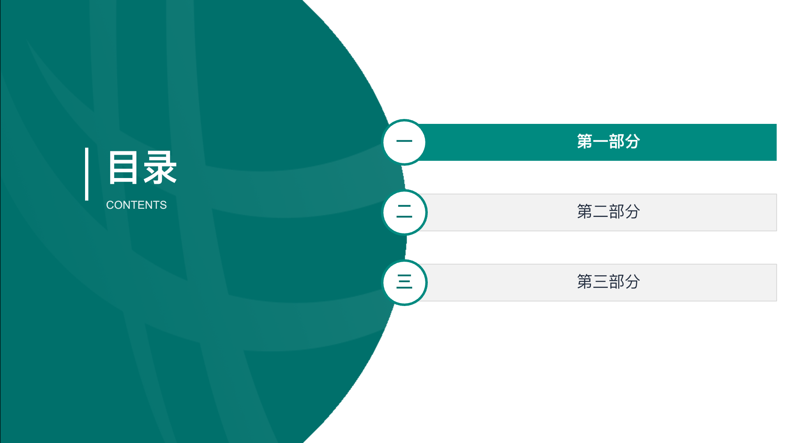
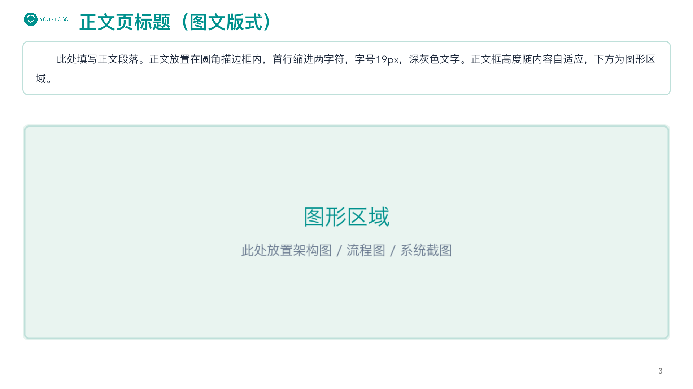
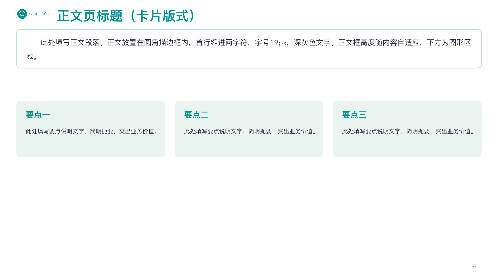

# Teal Corporate Report — 电网风格青绿企业汇报 PPT 模板（通用 Agent Skill）

一套**电网风格**的青绿色企业工作汇报 PPT 模板，封装为通用 AI Agent Skill（SKILL.md 规范，Claude Code / Codex / DeepSeek 等各类 AI 编码工具均可使用）。基于 slidep DSL 生成 `.pptx`，提供**封面 / 目录 / 正文（图文 & 卡片两种版式）/ 结束**五类页面骨架，全部参数化占位，填入内容即可成稿。

> 关键词：电网风格 PPT、电力行业汇报模板、青绿企业汇报、PPT 模板、PowerPoint template、Agent Skill、Claude Code、Codex、DeepSeek


## 效果预览

| 目录页 | 正文页（图文版式） | 正文页（卡片版式） |
|---|---|---|
|  |  |  |

## 风格规范速览

| 用途 | 色值 |
|---|---|
| 主标题 / 强调 | `#00918D` |
| 封面 / 结束页色带 | `#00706B` |
| 目录高亮条 | `#008A80` |
| 正文描边框 | `#BFE0DA` |
| 要点卡片底 | `#E9F4F0` |
| 正文文字 | `#1E293B` |

- 字体：微软雅黑（中文）+ Arial（西文/数字）
- 画布：1280 × 720
- 正文页骨架：左上 LOGO + 青色标题 + 圆角描边正文框（首行缩进）+ 下方图区/卡片区 + 右下角页码

## 目录结构

```
teal-corp-report/
├── SKILL.md            # 完整风格规范 + 生成流程 + 注意事项
├── assets/             # 视觉素材（logo.png 为占位图，请按需替换）
│   ├── logo.png
│   ├── band.png        # 封面/结束页色带纹理
│   └── catalog_bg.png  # 目录页弧形面板背景
├── templates/          # 页面骨架（只含样式与 {{占位符}}）
│   ├── cover.slide
│   ├── toc.slide       # 含 ACTIVE 参数控制当前章高亮
│   ├── content.slide   # 正文框 + 图形区
│   ├── content_cards.slide  # 正文框 + 三要点卡片
│   └── ending.slide
└── screenshots/        # 效果预览图
```

## 使用方法

1. 将整个文件夹复制到你所用工具的 skill 目录（SKILL.md 规范为通用约定）：
   - Claude Code：`~/.claude/skills/teal-corp-report/`
   - 其他支持 SKILL.md 的 Agent 工具：放入其 skills 目录即可
   - 不支持 skill 机制的工具：直接把 `SKILL.md` + `templates/` 当作模板规范文档使用
2. 让 AI 按本模板风格产出 PPT；或手动复制 `templates/` 骨架、替换 `{{占位符}}` 后用 slidep 逐页写入：
   ```bash
   slidep create "汇报.pptx"
   slidep upsert-dsl "汇报.pptx" --dsl-file slides/01.slide
   slidep lint "汇报.pptx" --dsl-file slides/01.slide --page-index 0
   ```
3. 替换 `assets/logo.png` 为你自己的 LOGO（901×307 或同比例图片）。

> ⚠️ 素材说明：`band.png` 与 `catalog_bg.png` 为通用青绿纹理图，`logo.png` 为程序生成的占位图。商用前请确认素材授权。

## License

MIT
